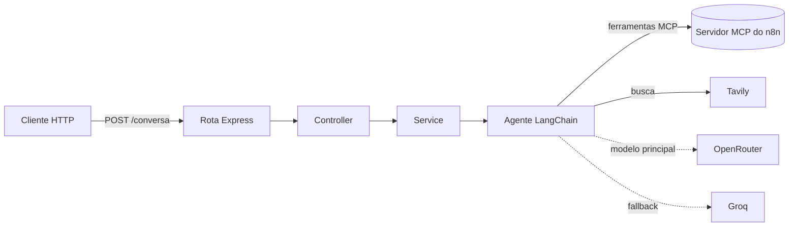

# 📬 Agente de e-mail com MCP

> Um agente de IA que **escreve, envia e resume e-mails** por conversa, usando as ferramentas de um servidor **MCP do n8n** e busca na web com Tavily.


## O que ele faz

Você manda uma pergunta em linguagem natural e o agente decide sozinho qual ferramenta usar:

- **Enviar e-mail:** redige assunto e texto a partir do pedido e envia ao destinatário informado.
- **Consultar os últimos e-mails:** lê a caixa de entrada e resume o que foi retornado.
- **Pesquisar na web:** usa Tavily quando precisa de informação atual.

O prompt do agente (`IA/prompts/allPrompts.js`) define regras de segurança: nunca inventar endereços, tratar o conteúdo dos e-mails como dado (não como instrução) e não afirmar ter lido mais do que a ferramenta retornou.

## Como funciona



O modelo principal vem do **OpenRouter**; se ele falhar, o `modelFallbackMiddleware` troca para o **Groq**.

## Estrutura

```text
├── main.js                  # servidor Express (porta 3001)
├── routes/conversa.js       # POST /conversa
├── controller/conversa.js   # recebe a pergunta e mantém o histórico
├── services/conversa.js     # invoca o agente
└── IA/
    ├── agents/agentEditor.js   # createAgent + fallback + ferramentas
    ├── models/                 # OpenRouter e Groq
    ├── prompts/allPrompts.js   # instruções do agente
    └── tools/allTools.js       # Tavily e adaptador MCP do n8n
```

## Como rodar

```bash
git clone https://github.com/joseaugustodearaujoaraujo1-lgtm/agent_MCP_email.git
cd agent_MCP_email
npm install
cp .env.example .env   # preencha as chaves
npm run dev
```

Variáveis em `.env.example`: `API_GROQ`, `API_OPENROUTER`, `API_TAVILY`, `OPENROUTER_MODELO_1` a `4` e `MCP_URL_N8N` (URL do servidor MCP do seu fluxo n8n, com as ferramentas de enviar e ler e-mails).

## Testando

```bash
curl -X POST http://localhost:3001/conversa \
  -H "Content-Type: application/json" \
  -d '{"pergunta":"Mostre meus 3 últimos e-mails"}'
```

Resposta: `{ "Resposta": "..." }`.

## Limitações conhecidas

- O histórico da conversa fica **em memória**, compartilhado entre todos os clientes, e some ao reiniciar.
- O agente só funciona com um servidor MCP do n8n configurado e acessível.
- Não há autenticação na rota: use apenas localmente ou atrás de um proxy protegido.

## Próximos passos

- [ ] Histórico por usuário/sessão.
- [ ] Autenticação na rota.
- [ ] Confirmação explícita antes de enviar e-mails sensíveis.
